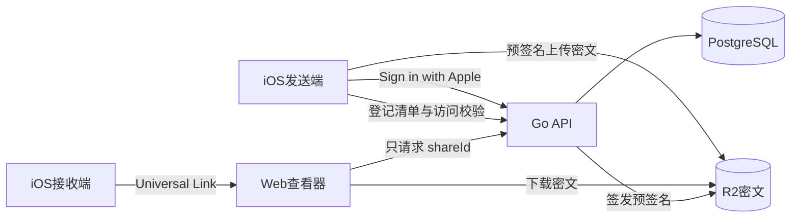

# imgmesh 技术架构

状态：第一版边界与加密常量已冻结。API、网页查看器和 iOS 工程已经按本文实现。当前这台 VPS 还没有配置 R2，密文先放在本机磁盘；预签名上传和下载的接口形状不变，配上 `S3_*` 环境变量后改为对象存储。

官网：https://imgmesh.com。本仓库目前只有营销站（`index.html`、`styles.css`、`favicon.svg`），由 `.github/workflows/deploy-website.yml` 同步到服务器 `/var/www/imgmesh/`。

## 产品

imgmesh 用来分享旅行照片。发送者在 App 里选多张照片，在本地加密后上传，把链接发出去。接收者以后仍能打开：浏览器里查看，装了 App 则可以存进系统相册。

营销站已经写明的承诺：

- 链接形态是 `https://imgmesh.com/s/…#k=…`
- 密钥放在链接片段里，服务端只存密文
- 浏览器随时能看；装了 App 可存进系统相册
- 能看到谁打开过、谁存过、谁在 imgmesh 里移除过这份分享
- 网络差时也能传完；点对点是加速，不是唯一通道
- 平台顺序：iOS，然后 Android，再 Windows、Mac

## 第一版边界

以下条目已冻结。改动需要先改本文。

- 持久化以对象存储为准。密文留在服务端，链接在发送者离线后仍可打开。点对点只在两端同时在线时加速传输，第一版不做。
- 每台设备只能注册一次，显示名称全站唯一。注册后名称可以改，但新名称也不能和别人重复。同一台设备再次注册会回到第一次的账号，不会新建第二个。
- 查看、下载和存相册都要先登记。服务器按注册用户记账，不采用客户端临时填写的名字。
- 发送和撤销仍要 Sign in with Apple，并且绑在这台已经注册的设备上。
- 「删除」只指 imgmesh 里的这份分享。存进系统相册之后，系统不提供可靠的删除回执。记录分三类：`view`（查看）、`download`（下载文件）、`save`（写入 iPhone 相册，并留在「在这些手机里」）。`remove` 表示从 imgmesh 收件箱移除，不把手机从「在这些手机里」拿掉。
- 旧的 `open` 与 `view` 都算查看。浏览器上报的 `save` 记成下载。
- 第一版只收图片：`image/jpeg`、`image/heic`、`image/heif`、`image/png`、`image/webp`。
- 单张明文上限 52,428,800 字节（50 MiB）。单次分享最多 200 张原图，原图明文合计最多 2,147,483,648 字节（2 GiB）。
- 每名发送者的配额先按 5,368,709,120 字节（5 GiB）配置。
- 原图字节原样加密，上传前不转码。浏览器能解码的直接显示。HEIC / HEIF 在浏览器里用 wasm 解码，解不了就提供原文件下载。wasm 解码放在实现顺序的第 4 步，不挡第 2 步的垂直切片。
- 缩略图是长边 480 像素的 JPEG，质量 0.70，保持比例，不放大小图。缩略图单独加密，图库先拉缩略图。
- 视频、Android、Windows、Mac、点对点传输，都不在第一版。
- 对象放 Cloudflare R2。API 和网页仍放现有 VPS。本地开发用 MinIO，接口与 R2 同为 S3。若改在 VPS 上跑 MinIO，要单独守磁盘水位。
- 撤销分享会删除 R2 上的对象并记下撤销时间。已经存进对方系统相册的副本留在对方设备上。

## 总体架构



密钥只出现在 URL 片段 `#k=`。浏览器请求不会带上片段。客户端不得把密钥写入查询串、请求头、Referer 或日志。微信抓取链接预览时拿不到片段。预览用固定的 imgmesh 卡片，不用照片内容。

## 加密常量

各端必须按本节实现，保证 iOS CryptoKit 与浏览器 WebCrypto 互通。

### 标识与密钥

| 名称 | 值 |
| --- | --- |
| `share_id` | 16 字节 CSPRNG。路径里使用 base64url、无填充（22 个字符） |
| `object_id` | 16 字节 CSPRNG。base64url、无填充 |
| `master_key` | 32 字节 CSPRNG。只放在片段里 |
| 链接 | `https://imgmesh.com/s/{share_id_b64}#k={master_key_b64}` |
| base64url | RFC 4648 §5，去掉 `=` 填充 |

`share_id` 会出现在访问日志里。只拿到 `share_id` 时，读接口还要访问校验值；两者一起也只能换到密文。

### 密钥派生

HKDF 按 RFC 5869，哈希为 SHA-256，输出 32 字节。

- IKM：`master_key` 的原始 32 字节
- salt：`share_id` 的原始 16 字节
- `manifest_key` 的 info：UTF-8 字符串 `imgmesh-manifest-v1`，不含结尾 NUL
- `file_key` 的 info：UTF-8 字符串 `imgmesh-file-v1`，不含结尾 NUL

原图和缩略图都用 `file_key`。每个对象单独生成 nonce。

### 对称加密

AES-256-GCM。

- nonce：12 字节 CSPRNG，可公开存储，每个对象一个
- tag：16 字节，附在密文末尾（WebCrypto 与 CryptoKit 的默认布局）
- AAD：`share_id` 原始 16 字节紧接 `object_id` 原始 16 字节，中间无分隔符

清单的 nonce 存在 `shares.manifest_nonce`，因为解密清单之前读不到清单内容。原图和缩略图的 nonce 写在清单明文里。

### 访问校验

```
access_tag = HMAC-SHA256(master_key, utf8("imgmesh-access-v1") || share_id_bytes)
```

`||` 是字节拼接，中间无分隔符。HMAC 密钥是 `master_key` 原始字节。结果 32 字节，在数据库和请求头里都用 base64url、无填充。

- 请求头名：`X-Imgmesh-Access`
- 创建分享时由发送端计算并提交，服务器保存
- 读元数据、取清单、取对象、上报事件都要带这个头
- 比较时使用常数时间比较

服务器能确认请求方持有链接，算不出 `master_key`。

## 清单格式

清单是一份 JSON，UTF-8，再用 `manifest_key` 加密。字段已冻结：

```json
{
  "v": 1,
  "title": "三亚",
  "items": [
    {
      "id": "<object_id base64url>",
      "name": "IMG_0001.HEIC",
      "mime": "image/heic",
      "bytes": 1234567,
      "nonce": "<12 字节 nonce 的 base64url>",
      "thumb": {
        "id": "<object_id base64url>",
        "bytes": 45678,
        "nonce": "<12 字节 nonce 的 base64url>"
      }
    }
  ]
}
```

- `v` 必须为 `1`
- `items` 的顺序就是展示顺序
- `bytes` 是加密前的明文长度
- `name` 来自相册文件名，可缺省
- 第一版垂直切片可以暂时不上传 `thumb`；格式里保留该字段，后续步骤补上

## 数据模型

PostgreSQL。标识列存原始字节或存 base64url 均可，但全库只选一种；推荐 `bytea` 存原始字节，API 边界再编码。

- `users`
  - `id`
  - `apple_sub`：可空，唯一。绑了 Apple 才能创建和撤销分享
  - `display_name`：非空时全站唯一，比较时忽略英文字母大小写
  - `bio`、`city`、`contact`：用户自己填写的介绍、城市和联系方式，用来在 App 里找到对方。可以为空
  - `created_at`
- `devices`
  - `id`：客户端生成一次并放在本机钥匙串或 localStorage，16 到 64 位
  - `user_id`：一台设备只对应一个用户
  - `platform`：`ios`、`web` 或 `desktop`
- `shares`
  - `id`：即 `share_id`
  - `owner_id`
  - `access_tag`
  - `manifest_object_id`
  - `manifest_nonce`：12 字节
  - `photo_count`
  - `total_bytes`：原图明文合计
  - `expires_at`：可空，空表示不过期
  - `revoked_at`：可空
  - `created_at`
- `objects`
  - `id`：即 `object_id`
  - `share_id`
  - `storage_key`：R2 / MinIO 对象键
  - `byte_size`：密文长度，含 tag
  - `kind`：`manifest`、`thumb`、`original` 之一
- `events`
  - `id`
  - `share_id`
  - `user_id`
  - `kind`：`view`、`download`、`save`、`remove`，以及旧数据里的 `open`
  - `client`：`web`、`ios`、`desktop`
  - `display_name`：当时的注册名称
  - `device_id`
  - `created_at`
- `holdings`
  - `share_id` + `user_id`
  - `device_id`
  - `client`
  - `saved_at`：iPhone 存入相册的时间。从 imgmesh 移除不会删除这条，因为系统相册里的照片还在
- `follows`
  - `share_id` + `user_id`
  - `created_at`：这个人选择了自动接收以后新增的照片。再打开同一条链接时，客户端只下载还没保存过的新照片
- `photo_cards`
  - `id`：照片身份证。客户端对原图明文做 SHA-256，再编成 43 位 base64url。服务器只存这个指纹，不存像素
- `photo_people`
  - `photo_id` + `user_id`
  - `shared`：这个人发出过这张照片
  - `saved`：这个人保存过这张照片
  - `from_user_id`：这份副本保存自谁。第一次记下之后不再改，所以后来再分享也不会把来源冲掉
  - `share_id`：最近一次登记时的分享
- `photo_likes`
  - `photo_id` + `user_id`：一个人对一张照片身份证点一次赞
- `friendships`
  - `user_low` + `user_high`：两个用户的一对关系，较小的 id 放在前面
  - `requester_id`：谁先申请
  - `status`：`pending` 或 `accepted`。对方再申请一次，或点接受，就变成好友
- `messages`
  - `sender_id`、`recipient_id`、`body`：好友之间的文字。正文存在服务器上，方便换设备继续看；只有这对好友能读写。照片本身仍然只存密文
- `message_reads`
  - `user_id` + `peer_id`：这个人读到对方消息的时间，用来算未读条数

清单里的 `items[].sha256` 是可选项，值与身份证相同。旧清单没有这个字段时，客户端在解开原图后自己计算。

对象键建议为 `{share_id_b64}/{object_id_b64}`，不要把密钥或明文文件名放进键。

撤销时删除该分享的全部对象，并写入 `revoked_at`。过期与撤销的分享拒绝新的上传和下载。`usage_totals.photos_transferred` 在原图第一次上传完成时加一，撤销不减，用来表示已经由软件传完的照片张数。

## API

全部在 `/v1`，由 Nginx 反代到本机 Go 进程。除创建会话和健康检查外，读分享的接口都要求 `X-Imgmesh-Access`。发送者管理接口要求会话。

- `POST /v1/register`：用设备号和名称注册。`platform` 可以是 `ios`、`web` 或 `desktop`。同一设备再调一次返回原来的用户。名称重复返回 `name_taken`
- `POST /v1/devices/session`：这台设备已经注册过时换一张会话
- `GET /v1/me`、`PATCH /v1/me`：查看和修改自己的名称、介绍、城市、联系方式
- `GET /v1/users?q=`：按名称、城市或联系方式找人
- `GET /v1/users/{id}`：查看对方的公开资料，以及分享、保存过的张数
- `GET /v1/photos?id=`：批量取照片身份证。返回谁分享了、谁有、谁保存了、保存自谁，以及赞的数量、自己是否赞过、最近点赞的人
- `POST /v1/photos/{id}/like`、`DELETE /v1/photos/{id}/like`：给一张已经登记的照片点赞或取消。照片还没有身份证时返回 `not_found`
- `GET /v1/friends`：好友、收到的申请、发出的申请。好友带上最后一条消息和未读数
- `POST /v1/friends`：向 `{userId}` 发申请。对方已经申请过自己时，这一次直接成为好友
- `POST /v1/friends/{id}/accept`、`POST /v1/friends/{id}/decline`：接受或拒绝申请。拒绝也会取消自己发出的申请
- `DELETE /v1/friends/{id}`：解除好友
- `GET /v1/messages?with=`：读取和某位好友的最近 50 条消息，并记为已读。还不是好友时返回 `not_friends`
- `POST /v1/messages`：给好友发一条不超过 1000 字的消息
- `GET /v1/stats`：公开的使用情况，不需要登录。返回用户数、设备数、已经传完的原图数，以及最近的登记、传图、查看、下载和保存。不返回链接或密钥
- `GET /v1/admin/overview`：管理明细。请求头 `X-Imgmesh-Admin` 要和服务器的 `ADMIN_TOKEN` 一致。返回用户、设备、分享、原图和最近动态。不返回密钥、访问标签或消息正文
- `POST /v1/shares/{id}/photos`：登记这组照片。发送者用 `shared`，保存的人用 `saved`
- `POST /v1/auth/apple`：校验 Sign in with Apple。带上现有会话时，把 Apple 绑到这个用户；没有会话时仍会建立发送者账号
- `POST /v1/shares`：创建分享，保存 `access_tag`，按配额预占
- `POST /v1/shares/{id}/uploads`：为一批对象签发 PUT 预签名。单对象明文超过 16 MiB 时改发 S3 multipart 的分片预签名
- `POST /v1/shares/{id}/uploads/complete`：核对密文大小，标记对象可读。同一对象重复完成保持成功。同一条分享可以再上传新照片和新的清单，链接和密钥不变
- `POST /v1/shares/{id}/follow`、`DELETE /v1/shares/{id}/follow`：打开或关闭「自动下载以后新增的照片」
- `GET /v1/shares/{id}`：返回张数、总大小、是否过期或已撤销，以及调用者是否打开了自动下载
- `GET /v1/shares/{id}/manifest`：返回清单对象 id、`manifest_nonce` 和短时 GET 地址。对象 id 要参与 AAD，所以必须一起返回
- `GET /v1/shares/{id}/objects/{oid}`：返回该对象的短时 GET 预签名
- `POST /v1/shares/{id}/events`：已注册用户上报 `view`、`download`、`save`、`remove`。名称以服务器上的用户为准
- `GET /v1/me/shares`：当前发送者的分享列表
- `GET /v1/shares/{id}/events`：发送者查看 `viewed`、`downloaded`、`phones`、`followers`
- `DELETE /v1/shares/{id}`：发送者撤销，并删除对象存储中的密文

预签名 PUT 有效期 15 分钟，GET 有效期 5 分钟。客户端把已完成的 multipart part 记在本地，中断后按未完成的 part 续传。

## 客户端

### iOS 发送端

SwiftUI，iOS 17+，CryptoKit，PhotoKit。用 PHPicker 选图，选图时不请求整库权限。在设备上加密，显示进度，失败后按未完成的 part 续传。完成后用系统分享面板发出带 `#k=` 的完整链接。

### Web 查看器

Vite + TypeScript，解密使用 WebCrypto。Nginx 把 `/s/*` 指到这个 SPA。页面只从 `location.hash` 读取 `k`。先取清单，再取缩略图或原图，解密后画网格和大图，并允许下载解密后的原图。打开成功后上报 `open`。视觉沿用营销站的纸色与海青色（`styles.css` 中的 `--paper`、`--ocean`）。

### iOS 接收端

与发送端同一个 App。Universal Link 打开 `https://imgmesh.com/s/…`，片段里的密钥一并交给 App。解密后以「仅添加」权限写入系统相册，写入成功才上报 `save`。用户在 App 内移除这份分享时上报 `remove`。选择「保存到相册」或打开「自动保存新增照片」之后，再打开同一条链接会把后来加上的照片写入相册。

## 仓库与部署

营销站留在仓库根目录。后续代码按目录加入：

- `server/`：Go API。路由用 chi，数据库用 pgx，对象存储用 aws-sdk-go-v2。启动时按版本执行 `internal/store/migrations` 里的 SQL
- `web/`：查看器
- `ios/`：Xcode 工程
- `docs/architecture.md`：本文
- `deploy/`：在现有 Nginx 站点上增加 `/v1/` 反代和 `/s/` 查看器；API 用 systemd 常驻。其余路径仍是营销站

GitHub Actions 在现有营销站 rsync 之外，再发布 API 二进制和 `web/dist`。数据库迁移放在发布步骤里执行。

## 实现顺序

1. 本文。加密常量和第一版边界以此为准。这一步不写产品代码。
2. 垂直切片：本地 Postgres + MinIO、创建分享、预签名上传、加密清单、Web 解密图库、iOS 选图上传并复制链接。验收：手机生成链接，电脑浏览器打开能看到原图；服务器磁盘和数据库里没有明文，日志和数据库里没有 `#k=` 或 `master_key`。
3. 账号、撤销和事件：Sign in with Apple、分享列表、过期、撤销、`open` / `save` / `remove`。iOS 接收端存入相册。
4. 传完的可靠性：缩略图优先、multipart 续传、HEIC 的 wasm 解码、通用链接预览卡片。
5. 点对点加速：两端在线时用 WebRTC 传密文，信令只走 API；任一端不在线则读取 R2。
6. Android，然后桌面。加密、清单和 API 保持不变，替换系统相册和后台传输。
